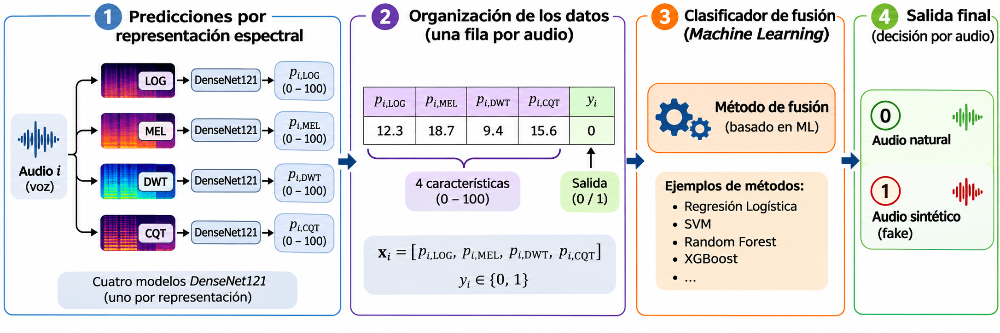

# Proyecto de Ciencia de Datos: Fusión de modelos para la detección de audios sintéticos

## 🎯 1. Contexto del proyecto

🎙️ La **detección de audios sintéticos (*audio deepfake detection*)** es un problema de clasificación binaria cuyo propósito es distinguir entre grabaciones de voz naturales y aquellas generadas o modificadas mediante técnicas de Inteligencia Artificial (IA).

🧠 Una estrategia para abordar este problema consiste en utilizar modelos de aprendizaje profundo (*Deep Learning*) entrenados sobre diferentes representaciones de una misma señal de voz. Aunque estos modelos realizan predicciones de manera independiente, **sus resultados pueden contener información complementaria que, al combinarse, permita mejorar el desempeño de la clasificación**.

🔬 En este proyecto trabajaremos con las predicciones de **cuatro modelos basados en la arquitectura DenseNet121**, cada uno entrenado con una representación diferente del audio:

- 📊 **LOG:** espectrograma logarítmico.
- 🎼 **MEL:** espectrograma en escala Mel.
- 🌊 **DWT:** transformada discreta Wavelet.
- 📈 **CQT:** transformada de Q constante.

⚙️ **¿Cuál es el reto?**

Diseñar e implementar un método de fusión basado en *Machine Learning* que aproveche las predicciones de los cuatro modelos para obtener **una única decisión por audio: natural (0) o sintético (1)**.

🏆 **La pregunta que guiará nuestro desafío es:**

**¿Podemos superar el desempeño de los modelos individuales mediante una estrategia inteligente de fusión y alcanzar el mayor F1 de la clase?**

## 🎯 2. Objetivo

🧠 **Diseñar, implementar y evaluar** un método de fusión basado en *Machine Learning* que combine las predicciones de cuatro modelos **DenseNet121**, correspondientes a las representaciones LOG, MEL, DWT y CQT, con el propósito de **maximizar el F1 de clasificación binaria** sobre un conjunto de validación interna.

## 📂 3. Descripción del dataset

🎙️ El archivo `fake_densenet121.csv` contiene las predicciones generadas por cuatro modelos DenseNet121 sobre un conjunto de audios naturales y sintéticos.

🔎 **¿Cómo están organizados los datos?**

Cada audio aparece en **cuatro registros**, uno por cada representación (LOG, MEL, DWT y CQT). Por tanto, las cuatro predicciones corresponden a una misma señal de voz, aunque sus valores pueden ser diferentes.

📋 **Columnas de interés:**

| Campo | Descripción |
|---|---|
| 🎵 **Identificador del audio** | Nombre del archivo WAV al que corresponde la predicción. |
| 📊 **Representación** | Tipo de representación utilizada: LOG, MEL, DWT o CQT. |
| 🔢 **`prediction`** | Valor entre 0 y 100 generado por el modelo DenseNet121. |
| 🏷️ **`ground_truth`** | Etiqueta verdadera del audio: 0 (natural) o 1 (sintético). |

💡 **¡Atención a este detalle!**

Los cuatro registros de un mismo audio deben compartir el mismo valor de `ground_truth`, pero pueden presentar diferentes valores de `prediction`.

⚙️ **Interpretación de las predicciones:**

- 🟢 **0 ≤ `prediction` < 50:** el modelo predice un audio natural.
- 🔴 **50 ≤ `prediction` ≤ 100:** el modelo predice un audio sintético (*fake*).

La columna `ground_truth` contiene las etiquetas verdaderas:

- **0:** audio natural.
- **1:** audio sintético (*fake*).

🚀 **El desafío:** transformar las cuatro predicciones de cada audio en un único conjunto de características que permita entrenar un clasificador de fusión basado en *Machine Learning*.

## ⚙️ 4. Metodología

  <em>Figura 1. Organización de las cuatro predicciones espectrales (LOG, MEL, DWT y CQT) y su integración mediante un clasificador de Machine Learning para la detección binaria de audios naturales y sintéticos.</em>

### 📊 4.1. Organización de los datos

🔍 **¿Cómo convertir cuatro predicciones en una única entrada para Machine Learning?**

El primer paso consiste en reorganizar el dataset original para obtener **una única fila por audio**, con la siguiente estructura:

- 📥 **Cuatro características de entrada (features):** una por cada representación espectral (LOG, MEL, DWT y CQT) perteneciente a un mismo audio. Cada característica corresponde a la predicción generada por el respectivo modelo DenseNet121 y debe conservar su valor original en el rango de 0 a 100.0.
- 📤 **Una variable de salida (*target*):** corresponde al valor de `ground_truth` del audio y debe ser **binaria (0 o 1)**.

Cada audio estará representado mediante un vector de cuatro características:

$$
\mathbf{x}_i =
\left[
p_{i,\mathrm{LOG}},
p_{i,\mathrm{MEL}},
p_{i,\mathrm{DWT}},
p_{i,\mathrm{CQT}}
\right]
$$

Donde $p_{i,r}$ representa la predicción del modelo DenseNet121 para el audio $i$, utilizando la representación $r$, y cumple:

$$
0 \leq p_{i,r} \leq 100
$$

La variable de salida corresponde a la etiqueta verdadera del audio:

$$
y_i = \mathrm{ground\_truth}_i \in \{0,1\}
$$

- 🟢 **0:** audio natural.
- 🔴 **1:** audio sintético (*fake*).

💡 **¡Importante!** Las cuatro características de entrada deben conservar sus valores originales entre 0 y 100, **sin convertirlos previamente en etiquetas binarias**. Por su parte, la variable de salida debe contener exclusivamente valores de 0 o 1.

Además, los cuatro registros correspondientes a un mismo audio deben compartir el mismo valor de `ground_truth`.

🎯 De esta manera, el problema se transforma en una tarea de **clasificación supervisada con cuatro características de entrada y una única variable de salida binaria por audio**.

### 🗂️ 4.2. División del dataset

📌 Una vez reorganizado el dataset, se realizará una **partición fija**, determinada por la numeración de los archivos de audio.

| Conjunto | Archivos | Propósito |
|---|---|---|
| 🧠 **Entrenamiento** | `1.wav` hasta `450.wav` | Entrenar el algoritmo de fusión. |
| 📈 **Validación interna** | `451.wav` en adelante | Evaluar el desempeño del método mediante F1. |

⚠️ **Condiciones obligatorias:**

1. ⚖️ Todos los grupos deben utilizar exactamente la misma partición del dataset.
2. 🔒 El conjunto de validación interna no podrá utilizarse para entrenar el clasificador ni ajustar sus hiperparámetros.

💡 **¿Por qué es importante?**

Esta división garantiza que todos los grupos desarrollen sus experimentos bajo las mismas condiciones, permitiendo **comparar de manera justa el desempeño de los métodos de fusión** y evitando la fuga de datos (*data leakage*) entre entrenamiento y validación.

### 🤖 4.3. Selección del método de fusión

🔬 **¡Aquí comienza el verdadero reto de investigación!**

Cada grupo deberá **investigar, seleccionar e implementar de manera autónoma** un algoritmo de *Machine Learning* que permita combinar las cuatro predicciones de DenseNet121 y generar una única decisión por audio.

La elección del algoritmo es libre, siempre que:

- 🧠 Permita resolver un problema de clasificación binaria.
- 📚 Se investigue y comprenda su principio de funcionamiento.
- ⚙️ Se justifique su selección para el problema de fusión.
- 💻 Se implemente correctamente utilizando Python.

Matemáticamente, el proceso de fusión puede expresarse como:

$$
\hat{y}_i = f_{\theta}(\mathbf{x}_i)
$$

Donde:

- $\mathbf{x}_i$: vector de cuatro predicciones del audio $i$.
- $f_{\theta}$: clasificador de fusión basado en *Machine Learning*, con parámetros $\theta$ aprendidos durante el entrenamiento.
- $\hat{y}_i$: predicción final del audio.

La salida del clasificador será:

$$
\hat{y}_i \in \{0,1\}
$$

- 🟢 **0:** audio natural.
- 🔴 **1:** audio sintético.

💡 **Libertad de exploración:** los estudiantes podrán investigar diferentes algoritmos, estrategias de preprocesamiento, mecanismos de clasificación y procedimientos de selección de hiperparámetros, siempre que respeten la partición establecida.

### 📈 4.4. Evaluación del método de fusión

🏆 **¿Qué tan buena es la estrategia de fusión desarrollada?**

El desempeño se evaluará mediante el **F1-score**, calculado exclusivamente sobre el conjunto de validación interna.

Esta métrica combina la precisión (*Precision*) y la sensibilidad (*Recall*) mediante su media armónica:

$$
F1 = \frac{2PR}{P+R}
$$

Donde:

- **$P$ — Precision:** proporción de audios clasificados como sintéticos que realmente son sintéticos.
- **$R$ — Recall:** proporción de audios sintéticos que fueron correctamente identificados.

La clase positiva será la correspondiente a los audios sintéticos (`ground_truth = 1`).

📌 **Condiciones de evaluación:**

- Cada audio debe producir una única predicción fusionada.
- El F1 debe calcularse comparando las predicciones fusionadas con las etiquetas verdaderas.
- Todos los grupos deben evaluar sus modelos sobre el mismo conjunto de validación interna.

🏆 **¡El desafío final!**

**El grupo ganador será aquel que obtenga el mayor F1 de clasificación binaria en el conjunto de validación interna.**

Sin embargo, el desempeño no será el único aspecto evaluado: también se valorará la capacidad de **investigar, comprender y justificar técnicamente el método de fusión seleccionado**.

## 🎓 5. Resultados de aprendizaje

Este proyecto permitirá evaluar dos resultados de aprendizaje, relacionados con la **experimentación computacional** y la **investigación autónoma de técnicas de Ciencia de Datos**.

🔬 **RA 6.1. Experimentación y análisis de resultados**

Diseña y ejecuta experimentos computacionales sobre datos estructurados, series de tiempo y señales de voz, comparando distintas estrategias de análisis, preprocesamiento, ingeniería de características o modelado, interpretando los resultados mediante métricas apropiadas y proponiendo mejoras a partir de la evidencia obtenida.

🧠 **RA 7.1. Investigación y aprendizaje autónomo**

Investiga, selecciona e incorpora de manera autónoma una técnica, herramienta o estrategia relacionada con Ciencia de Datos que no haya sido desarrollada explícitamente en clase, justificando su integración dentro de la solución de un problema basado en datos estructurados, series de tiempo o señales de voz mediante Python.

---

## 🏆 6. Rúbrica de evaluación

La evaluación contempla **dos criterios complementarios**: el desempeño experimental del método de fusión y la calidad de la investigación y justificación de la técnica seleccionada.

### 🔬 Criterio 1. Experimentación y evaluación de la fusión de modelos para la clasificación de voz (RA 6.1)

**⚖️ Peso: 65 %**

Diseña, implementa y evalúa en Python una solución de fusión de modelos para la clasificación binaria de voz (natural/sintética), utilizando *Machine Learning* y la métrica F1-score para medir su desempeño.

| Nota | Descripción |
|:---:|---|
| **0.0** | No diseña ni implementa una solución de fusión de modelos utilizando *Machine Learning* en Python. |
| **3.5** | Diseña e implementa una solución de fusión de modelos utilizando *Machine Learning* en Python, pero el F1 obtenido es significativamente inferior al mejor resultado alcanzado por los grupos de la clase. |
| **4.2** | Diseña e implementa una solución de fusión de modelos utilizando *Machine Learning* en Python y obtiene un F1 ligeramente inferior al mejor resultado alcanzado por los grupos de la clase. |
| **5.0** | Diseña e implementa una solución de fusión de modelos utilizando *Machine Learning* en Python y obtiene el mayor F1 entre los grupos de la clase. |

### 🔍 Criterio 2. Investigación y justificación de métodos de fusión basados en Machine Learning (RA 7.1)

**⚖️ Peso: 35 %**

Investiga métodos de fusión basados en *Machine Learning* para la clasificación de voz (natural/fake) y justifica la selección y el funcionamiento del método elegido.

| Nota | Descripción |
|:---:|---|
| **0.0** | No investiga métodos de fusión basados en *Machine Learning* para la clasificación de voz (natural/fake), ni justifica la selección y el funcionamiento del método utilizado. |
| **3.0** | Investiga métodos de fusión basados en *Machine Learning* para la clasificación de voz (natural/fake), pero justifica parcialmente la selección y el funcionamiento del método elegido. |
| **5.0** | Investiga métodos de fusión basados en *Machine Learning* para la clasificación de voz (natural/fake) y justifica correctamente la selección y el funcionamiento del método elegido. |

### 🧮 Calificación definitiva

La nota final del proyecto se calculará mediante la siguiente expresión:

$$
\text{Nota final} = 0.65C_1 + 0.35C_2
$$

Donde:

- 📈 **$C_1$:** calificación del desempeño del método de fusión (65 %).
- 🔍 **$C_2$:** calificación de la selección y justificación del método de clasificación (35 %).

💡 **¡Recuerda!** Obtener el mayor F1 es importante, pero también lo es comprender el método utilizado y justificar las decisiones tomadas.

**🚀 El verdadero desafío consiste en combinar un buen desempeño experimental con una solución técnicamente fundamentada.**

## 🔒 Publicación en GitHub

1. 📂 Cada estudiante o equipo deberá crear un repositorio en **GitHub con visibilidad privada (`Private`)**.

2. 👩‍🏫 La docente del curso deberá ser agregada como colaboradora del repositorio privado, utilizando su usuario de GitHub: **[@doramariaballesteros](https://github.com/doramariaballesteros)**, para que pueda consultar y evaluar los archivos publicados.

3. 💻 El repositorio deberá contener:
   - Un **notebook de Python (`.ipynb`)** con código ejecutable, organizado de acuerdo con las etapas de la metodología: organización de los datos, partición del dataset, implementación del método de fusión y evaluación mediante F1-score.
   - Una **justificación técnica del método de fusión seleccionado**, incluyendo la investigación realizada, su principio de funcionamiento y las razones de su elección.
   - Los **resultados experimentales**, incluyendo el F1 obtenido sobre el conjunto de validación interna y su correspondiente análisis.
   - La **documentación necesaria** para comprender y reproducir los procedimientos realizados.

4. 🔗 El enlace del repositorio deberá ser compartido con la docente para su evaluación.

5. 📅 Los archivos correspondientes al proyecto deberán estar publicados en el repositorio **a más tardar en la fecha de entrega establecida**.

💡 **¡Importante!** El notebook debe permitir reproducir el proceso completo de fusión y evaluación. No basta con presentar el valor final del F1: **el código, las decisiones metodológicas y los resultados deben ser verificables**.

## 8. Duración

Tiempo disponible: dos semanas a partir de la asignación del proyecto (hasta 17 de noviembre de 2026).

**📌 El objetivo no es únicamente obtener un F1 elevado, sino demostrar la capacidad de investigar, seleccionar, implementar y justificar una solución de Ciencia de Datos basada en evidencia experimental.**
